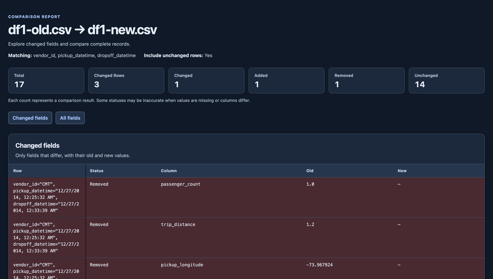

# py-compare-df

A Python tool for comparing pandas DataFrames and data files.

## Installation

Requires Python 3.10 or later. From the repository root:

```bash
python -m pip install ./py-compare-df
```

## Usage

Compare two CSV or JSON files and write the differences:

```bash
py-compare-df first.csv second.csv --output differences.csv
```

Use `--method` to select `merge` (default), `join`, or `compare`:

```bash
py-compare-df first.csv second.csv --method join --debug
```

Other options include `--on` for join keys and `--keep-all` to retain matches
or equal values normally omitted. Use `--output` to save results or `--debug`
to print them; without either, the command produces no output. Run
`py-compare-df --help` for all options. You can also use
`python -m py_compare_df`.

### Diff reports

Generate a side-by-side Markdown or standalone HTML report using the join
method:

```bash
py-compare-df-diff old.csv new.csv --on id --output changes.html
py-compare-df-diff old.csv new.csv --on id --keep-all --output changes.md
```

Reports omit unchanged rows unless `--keep-all` is provided. Without `--on`,
rows are matched by index (usually position for CSV and JSON files).

To create a unified-style diff from the same join comparison:

```bash
py-compare-df-diff old.csv new.csv --on id --output changes.diff
```

Each changed, removed, or added join result is a hunk with full JSON records
labeled `old` and `new`. Records contain `keys` when `--on` is used, or
`index` otherwise, and a `values` object for the fields on that side.

Missing fields are omitted, nulls become JSON `null`, and dates use ISO format.
Unchanged rows are omitted from `.diff` even with `--keep-all`. This is a
comparison report, not a patch guaranteed to apply to either input file.

### Python API

```python
from py_compare_df import compare

result = compare(old=df1, new=df2, on=["id"], keep_all=True)
```

For diff output, `diff` writes the selected format and returns its path:

```python
from py_compare_df.diff import diff

path = diff(df1, df2, "changes.html", on=["id"], title="Inventory changes")
```

The optional title defaults to `DataFrame diff` and applies to HTML and
Markdown; it does not change `.diff` output. The Python API overwrites
existing output files by default.

### Notes

- Keys should uniquely identify rows; duplicate keys can create multiple matches.
- `merge` matches shared columns by default. `--keep-all` retains matching
  keys as `Both`, even if other values differ.
- `join` uses indexes by default; `--on` matches columns in both inputs and
  includes the keys in the output. Its presence heuristic can misclassify
  key-only rows, null-only values, or disjoint non-key columns.
- `compare` requires identical index and column labels in the same order;
  `--on` sets the index columns. Exporters omit its row labels; use `--debug`
  to inspect them.

## Screenshots


